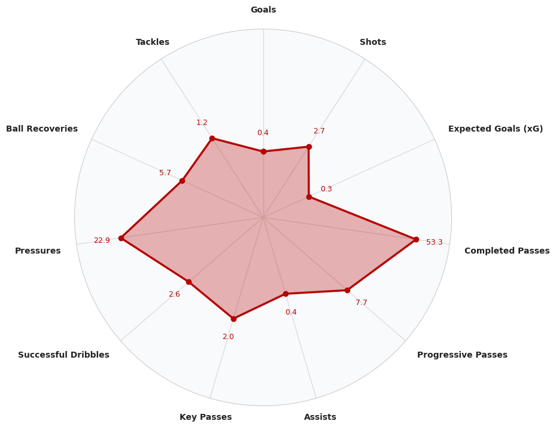

# Florian Wirtz — Football Performance Dashboard

**An interactive football analytics dashboard exploring Florian Wirtz's Bundesliga 2023/24 performances through passing, shooting, dribbling and team connections.**

## Dashboard

### [Open the interactive dashboard](https://handsomely-chocolate-beaver-63faad0b.plotly.app/)

The dashboard link above was supplied by the project author. Its current availability was not verified during repository preparation.

Built with **Python, Dash and Plotly** as an academic project for *Visualização Avançada de Dados* at the University of Coimbra. The application brings event-level football data into a visual interface designed to support exploration of a player's performance.

## Explore the analysis

- **Player overview:** profile information and technical comparisons through radar images.
- **Passing:** successful and unsuccessful passes, key passes, assists, pass direction and pass length.
- **Shooting:** shot locations, expected goals (xG), shot outcomes and contextual hover information.
- **Dribbling:** successful and unsuccessful dribbles, including nutmeg-related views.
- **Team connections:** a passing network for selected Bayer Leverkusen players.
- **Spatial activity:** a supplied heatmap image alongside pitch-based visualizations.

Dash callbacks allow users to switch passing and dribbling views and select comparison images. Some panels are interactive Plotly figures; radar comparisons and the heatmap are pre-rendered assets, not charts recalculated from live data.



## Technology stack

| Area | Technologies |
| --- | --- |
| Web application | Dash, HTML components, CSS, JavaScript |
| Interactive charts | Plotly |
| Data preparation | pandas, NumPy, JSON |
| Supporting visualizations | Matplotlib, Seaborn, Pillow |
| Network analysis | NetworkX |
| Scaling | scikit-learn |
| Exploratory analysis | Jupyter, statsbombpy, ydata-profiling |

## Data source

The project uses **StatsBomb Open Data**. The dashboard is configured for:

| Setting | Value |
| --- | --- |
| Player | Florian Wirtz |
| Competition | Bundesliga |
| Season | 2023/24 |
| Competition ID | `9` |
| Season ID | `281` |

Source: [StatsBomb Open Data repository](https://github.com/statsbomb/open-data).

**The event dataset was not included in the uploaded project and is not bundled in this repository.** To run the application locally, obtain the JSON files from the source repository and retain its directory structure.

The application expects `data/matches/9/281.json` and an event file at `data/events/<match_id>.json` for every match referenced in that match list. Copying the source repository's complete `data/` directory into this project's root is the simplest way to preserve the expected structure, although it also includes data not needed by this dashboard. For a smaller download, retain the competition/season match file and all its referenced event files.

The exploratory notebook also analyzes comparison players and may require additional competitions and seasons beyond the dashboard's main dataset.

### Attribution

Football event data is provided by **StatsBomb**. Consult the [upstream terms and attribution guidance](https://github.com/statsbomb/open-data#terms--conditions) before publishing data-derived analysis, including its logo requirement. The dataset and supplied player imagery are not relicensed by this repository.

## Repository structure

| File or directory | Purpose |
| --- | --- |
| [`app.py`](app.py) | Dashboard layout, initial chart generation and callbacks |
| [`visualizations.py`](visualizations.py) | Data processing and chart functions |
| [`assets/`](assets/) | Styles, JavaScript, player image and pre-rendered charts |
| [`analysis.ipynb`](analysis.ipynb) | Original exploratory notebook, with stored outputs removed |
| [`requirements.txt`](requirements.txt) | Dashboard dependencies inferred from source imports |
| [`requirements-notebook.txt`](requirements-notebook.txt) | Additional exploratory notebook dependencies |
| `data/` | Local StatsBomb JSON dataset; not bundled or tracked |

## Run locally

Use Python 3.11 as a starting environment. The original project did not provide a dependency lockfile; the supplied dependency ranges are a starting specification, not a reproduced or tested original environment.

From the project root, on Windows PowerShell:

```powershell
python -m venv .venv
.\.venv\Scripts\Activate.ps1
python -m pip install -r requirements.txt
```

On macOS/Linux, activate the environment with `source .venv/bin/activate` instead.

Add the dataset in the structure described above, then run:

```bash
python app.py
```

Open <http://127.0.0.1:8050/> in your browser. Keep the terminal working directory at the repository root: data and image paths are relative to that directory.

The application generates several figures before starting the server. Startup may take time while event files are loaded. Missing input files will prevent startup or result in incomplete views, depending on the function.

### Explore the notebook

From the same project root:

```bash
python -m pip install -r requirements-notebook.txt
jupyter lab analysis.ipynb
```

Notebook outputs have been cleared to keep the repository compact. Run the cells with the required datasets available to regenerate the analysis. Any API-based notebook cells may also require network access.

## Interpretation and scope

- This is a historical, player-focused dashboard, not a live match feed or a general-purpose scouting platform.
- xG values come from the event data; the project does not train an xG model.
- Pitch events describe recorded actions, not continuous player tracking. They should not be interpreted as complete movement trajectories.
- The passing network uses predefined display positions for selected players, not measured average tracking positions.
- Player comparisons use supplied static images; changing the main player does not regenerate those assets.
- Several functions contain fixed player, competition and season settings. Adapting the dashboard to a different player requires reviewing those functions as well as the top-level configuration.
- `app.py` enables Dash debug mode for local development. Production deployment should use an appropriate server configuration; the Flask server is exposed as `server`.

## Validation and packaging

The code-only package preserves the application logic and visual assets. It excludes the report PDF and removes notebook outputs and execution counts. Dependency files and a `.gitignore` were added for repository use.

Python syntax, notebook structure, local documentation links and ZIP integrity were checked during packaging. The dashboard was not run end-to-end because the event dataset was absent. No passing runtime test or live-site availability is claimed.

## Authors

- Daniel Filipe Pardal Monteiro
- Francisco Rua Ferreira

Academic group project — Advanced Data Visualization, University of Coimbra, 2025.
